I'm a full-stack developer in Pakistan. I build React frontends and Python backends, and more and more of what sits between them is an AI feature that has to hold up with real users.

I like the parts of the job that never make the demo: reading the logs properly, making a deploy boring, leaving a codebase easier to change than I found it. Most of my work is in private repositories, so the contribution graph says more about me than the pinned repos do.

## What I work with

| Area | Tools |
| :--- | :--- |
| Frontend | React, TypeScript, JavaScript, MUI |
| Backend | Python, Django, FastAPI, Node.js |
| Data | PostgreSQL, MySQL, MongoDB, Redis |
| Infrastructure | Docker, Linux, Traefik, Dokploy |
| AI | LLM-backed features and the tooling around them |

## slowserver

The rack at the top is a drawing. The server is real: [slowserver.net](https://slowserver.net) runs on a mini PC at home, and I tinker with it far more than I should.

| Layer | What's there |
| :--- | :--- |
| Hardware | Mini PC, 12th-gen Intel i5, 32 GB RAM |
| System | Ubuntu Server, with everything in Docker |
| Deploys | Dokploy, a self-hosted PaaS |
| Ingress | Traefik, with automatic HTTPS for every service |
| Services | Media, file storage, S3-compatible object storage, and my own apps |

Around it sit the routers, switches, DNS and firewalls. If it has blinking lights, I want to configure it.

## Get in touch

Ask me about React, Python, AI, homelabs, or anything to do with space.

- Email: [abdulrehman.ajmal@outlook.com](mailto:abdulrehman.ajmal@outlook.com)
- X: [@notabdulrehman](https://x.com/notabdulrehman)
- Homelab: [slowserver.net](https://slowserver.net)
