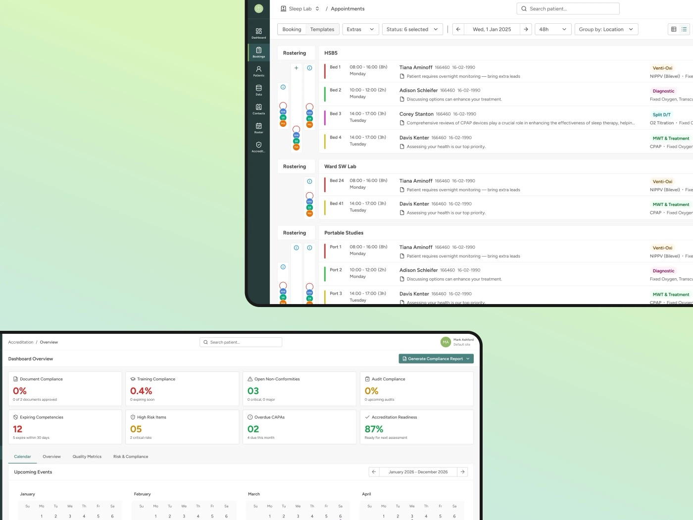
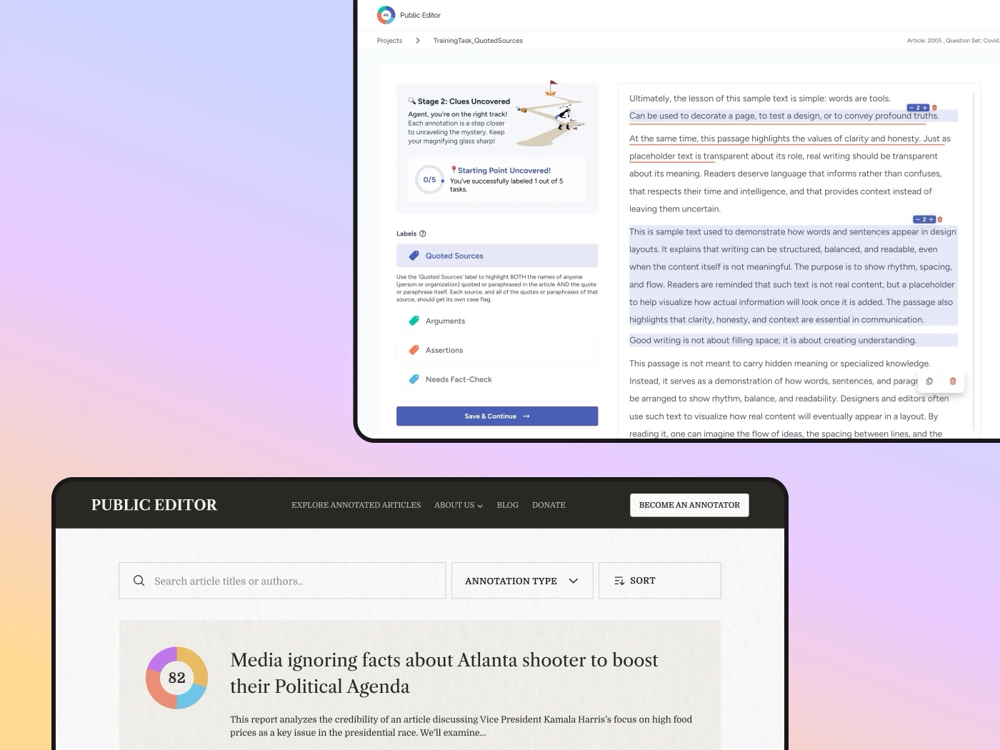

I'm a full-stack engineer in Pakistan. I work two engineering jobs, go to the gym after them, and then come home to a mini PC I named slowserver.

I like building things a person can hold: an app on a phone, a dashboard a clinic opens every morning, a voice that picks up when you call a number. I also like knowing how things work a few layers below where I'm paid to work, which is why the reading list at the bottom runs from transistors to rockets.

Almost all of this code lives in private repositories, so here are the pictures instead.

## Things I've shipped

### Clinical reporting and lab management platform

Two years and 900+ of my commits on a multi-site platform for respiratory and sleep labs. It follows a patient from referral and waitlist through booking, rostering and testing to the finished clinical report, then delivers the result to the referring doctor over HL7. I also worked on the accreditation module, which tracks documents, training, audits and corrective actions. The client's name is withheld at their request.

React · TypeScript · MobX · Apollo GraphQL · AG Grid · Flask · Hasura · PostgreSQL

### [siParadigm](https://carteblanche.tech/case-studies/siparadigm)

An iOS and Android app for a molecular diagnostics lab. Doctors track cases and download reports, order sample kits and follow the FedEx delivery. The company had shelved two earlier attempts; this one was in production in two months. No patient data is stored on the phone.

React · TypeScript · Ionic · Capacitor · React Aria · Tailwind

### [Nowii Rewards](https://carteblanche.tech/case-studies/nowii)

A rewards app for a London startup that pays commuters in tokens for travelling green. You earn tokens, climb tiers and spend them on discounts with partner merchants, and the app shows the CO₂ you saved along the way. The MVP launched in three months.

React · Ionic · TypeScript · Tailwind · Django · PostgreSQL · Celery · AWS

### [Public Editor](https://carteblanche.tech/case-studies/public-editor)

A platform that scores how credible a news article is. Twelve Claude agents on Amazon Bedrock read each article for sourcing, reasoning, language and evidence, so an analysis that took days now takes minutes. It also has a training game for human annotators and a browser extension for annotating articles in place.

React · Next.js · TypeScript · D3 · Django · PostgreSQL · Amazon Bedrock · Docker

### [HireCinch](https://carteblanche.tech/case-studies/hirecinch)

A multi-tenant applicant tracking system for startups and small companies. It parses and screens resumes with AI, and gives each team its own hiring pipeline, application forms, scorecards, interview scheduling and email. The MVP was live in eight weeks.

Next.js · React · TypeScript · Tailwind · Django · PostgreSQL · Celery · Redis · AWS

## Agents that pick up the phone

At my second job, a small team and I build the assistant for a property developer's customers. More than 500 of the commits are mine.

**The voice agent.** Call the number and an agent answers, built on Twilio and ElevenLabs. If you're a new caller it talks you through the projects, notes what you're looking for, creates the lead in Salesforce and books a consultation. If you're an existing customer, a different agent picks up: it can tell you what is paid and what is due on your unit, open a support case, or email you a document. ElevenLabs runs the conversation, and every action is a webhook tool that calls back into our Django backend, so the business rules live in one place.

**The WhatsApp agent.** The same assistant started life on WhatsApp, where it does the same job in text: answers questions, captures leads, books consultations and handles support, with message templates and buttons managed per tenant.

Under both sits a multi-tenant Django API that keeps a read-only mirror of the client's Salesforce data for the agents to answer from.

## slowserver

[slowserver.net](https://slowserver.net) is an HP Elite Mini 600 G9 at home that works as my own small cloud, and I tinker with it far more than I should.

| Layer | What's there |
| :--- | :--- |
| Hardware | Intel i5-12500T, 32 GB RAM, running on the house battery backup |
| System | Ubuntu Server, Docker Swarm |
| Deploys | Dokploy, a self-hosted PaaS. I moved the whole stack over from CapRover and nginx |
| Ingress | Traefik with automatic HTTPS on every subdomain |
| Media | Jellyfin with hardware transcoding on the Intel iGPU, AV1 included |
| Also running | S3-compatible object storage, a file manager, uptime monitoring, and my own apps |

I've set up my own mail server as well. Everything is written down in a wiki in git, because the person most likely to break this server is me in six months.

## Smaller things

- **Tabiya** is a free chess opening trainer I'm building for players rated 600 to 1200. It teaches ten courses with spaced repetition, and Stockfish audits every line to catch any taught move that loses ground. Not published yet.
- **[Voklizer](https://github.com/Pineapple-1/voklizer)** is a voice-message app for iOS and Android, built with Ionic, Capacitor, Firebase and Stripe.
- **Open source:** a handful of pull requests to [eraeco/pay](https://github.com/eraeco/pay), a peer-to-peer check payment system.
- **Old experiments** are still here from when I was learning computer vision: an [invisibility cloak](https://github.com/Pineapple-1/Invisiblity-cloak) in OpenCV, and live [pose, face and hand tracking](https://github.com/Pineapple-1/holistics).

## Teaching

I mentor [Wali](https://github.com/WaliShykh), a younger developer who is learning to build software. Explaining something to him is the fastest way I know to find out whether I understand it.

## What I read about when nobody is paying me

- **Radio and mesh networks.** LoRa, Meshtastic, and how far a few milliwatts can carry a message. I want to build my own slightly piratical off-grid network.
- **Running AI at home.** Deploying models locally, how people cluster Mac Studios into one machine, and what NVLink does for stacked GPUs.
- **How chips are made.** EUV lithography, and the nanoimprint machines Canon is building to get around it. Further down, how a FET transistor actually switches.
- **Rockets.** SpaceX and Starship, and at the other end of the scale, how hobby rockets work.
- **Drones,** and most other things that fly.
- **Films.** I've watched a lot of them, and I like telling stories.

## What I work with

| Area | Tools |
| :--- | :--- |
| Frontend | React, Next.js, TypeScript, Tailwind, React Aria, Ionic and Capacitor |
| Backend | Python, Django and DRF, FastAPI, Flask, Hasura, GraphQL |
| Data | PostgreSQL and SQL, Redis, Celery |
| AI | LLM agents and pipelines with Claude on Bedrock and OpenAI, voice agents with Twilio and ElevenLabs |
| Infrastructure | Docker, Linux, Traefik, Dokploy, AWS, CI/CD |

## Get in touch

Ask me about React, Python, agents, homelabs, or anything that leaves the ground.

- Email: [abdulrehman.ajmal@outlook.com](mailto:abdulrehman.ajmal@outlook.com)
- LinkedIn: [abdulrehman-ajmal](https://www.linkedin.com/in/abdulrehman-ajmal-a270891a4/)
- X: [@notabdulrehman](https://x.com/notabdulrehman)
- Homelab: [slowserver.net](https://slowserver.net)
