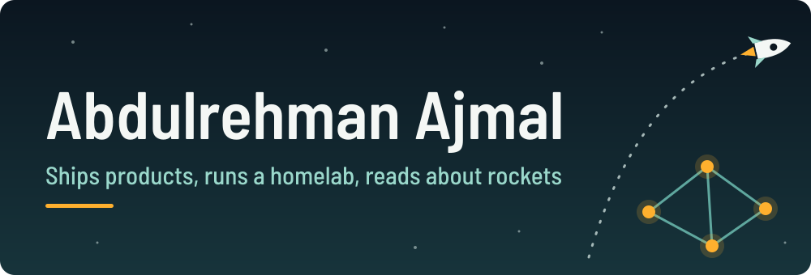
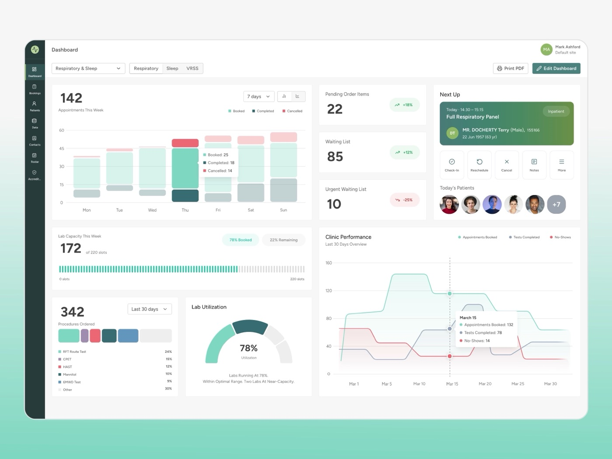
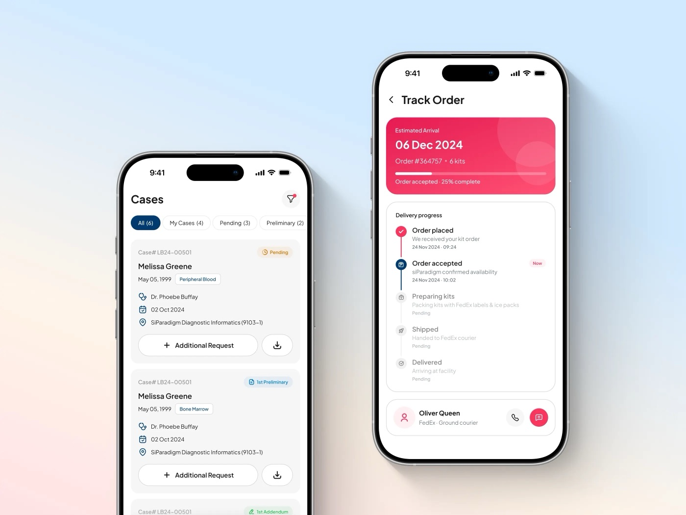
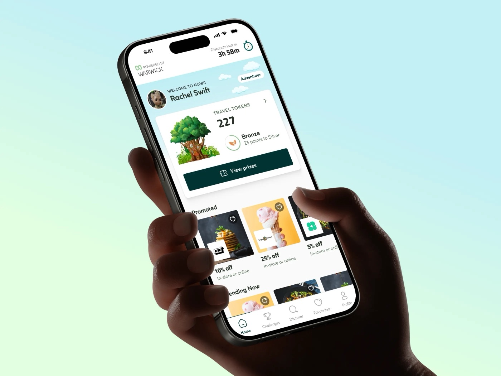
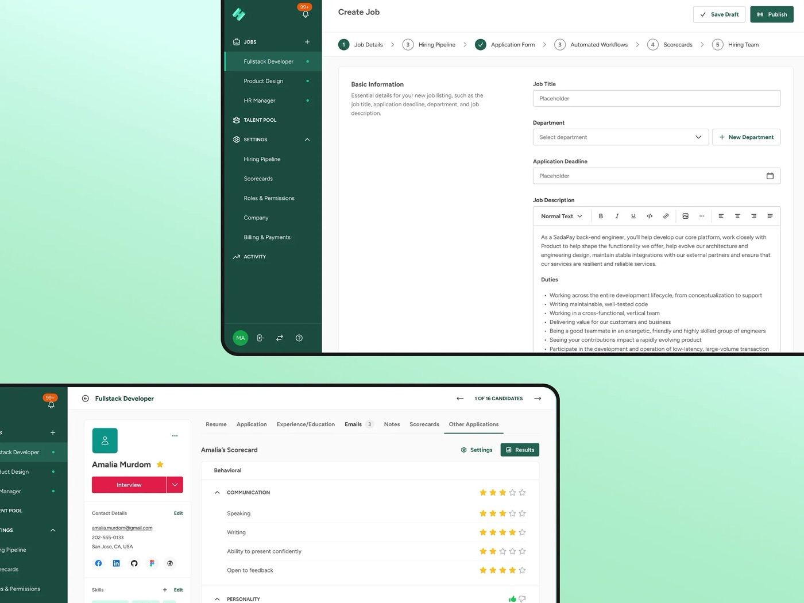
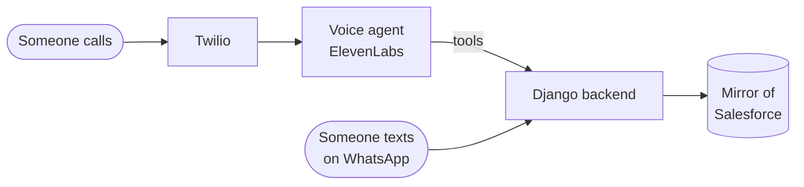
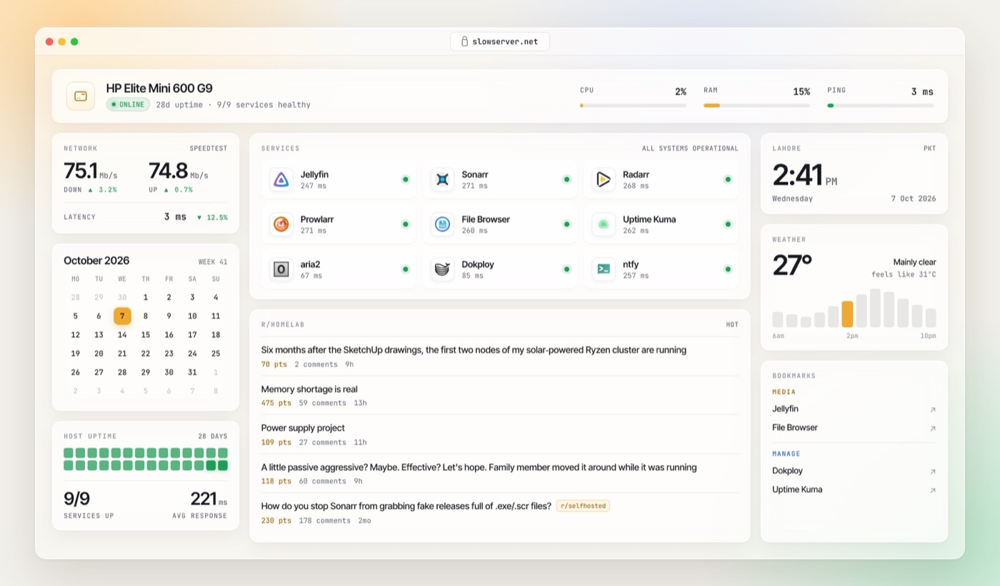

***Self-portrait as a LoRa packet***, 2026 
Chirps on a dark ground. The top row is the preamble a LoRa radio sends before it speaks. The two rows under it are my name, one chirp per letter: the later the letter in the alphabet, the higher the chirp starts. The <a href="scripts/build_banner.py">script that draws it</a> is in this repo.

---

I'm Abdulrehman. This is where I hang the things I make.

Most of the code is in private collections, so what's on the walls is pictures. Walk around.

## Room 1: Commissions

**Clinical reporting and lab management platform**, 2024 to now 
React, TypeScript, MobX, Apollo GraphQL, AG Grid, Flask, Hasura, PostgreSQL

A platform for respiratory and sleep labs. It follows a patient from referral and waitlist through booking, rostering and testing to the finished clinical report, and delivers the result to the referring doctor. The client's name is left off the label at their request.

 

**[siParadigm](https://carteblanche.tech/case-studies/siparadigm)**, 2024 to 2026 
React, TypeScript, Ionic, Capacitor, React Aria, Tailwind

An iOS and Android app for a molecular diagnostics lab. Doctors follow their cases, download reports, order sample kits and watch the courier bring them.

 

**[Nowii Rewards](https://carteblanche.tech/case-studies/nowii)**, 2023 to 2024 
React, Ionic, TypeScript, Tailwind, Django, PostgreSQL, Celery, AWS

An app for a London startup that pays commuters in tokens for travelling green. You earn tokens, climb tiers and spend them on discounts with partner merchants.

 

**[Public Editor](https://carteblanche.tech/case-studies/public-editor)**, 2024 to 2025 
React, Next.js, TypeScript, D3, Django, PostgreSQL, Amazon Bedrock, Docker

A tool that reads a news article and tells you how far to trust it. Twelve AI agents go through it for sourcing, reasoning, language and evidence. There is also a game that trains people to do the same job.

 

**[HireCinch](https://carteblanche.tech/case-studies/hirecinch)**, 2022 to 2023 
Next.js, React, TypeScript, Tailwind, Django, PostgreSQL, Celery, Redis, AWS

An applicant tracking system for small companies: hiring pipelines, application forms, scorecards, and AI that reads the resumes first.

## Room 2: Things that talk

There is nothing to hang in this room. The pieces are voices.

**Voice agent**, 2025 to now 
Twilio, ElevenLabs, Django, Salesforce

Call a property developer's number and an agent answers. A new caller hears about the projects and can book a consultation. An existing customer gets a different agent, one that knows what they have paid and what is due, and can open a support case or email a document. Made with a small team.

**WhatsApp agent**, 2025 to now 
Twilio, WhatsApp, Django, Salesforce

The same assistant, in text. It came first, and the voice grew out of it.

## Room 3: The machine at home

**[slowserver.net](https://slowserver.net)**, ongoing 
HP Elite Mini 600 G9, Ubuntu Server, Docker Swarm, Dokploy, Traefik

A mini PC in my house that works as my own small cloud. It serves films, stores files, hosts my apps and gets HTTPS for every one of them on its own. It runs on the house battery when the power goes. I have also run my own mail server. I tinker with all of it far more than I should.

## The sketchbook

Smaller things, some unfinished.

- **Tabiya.** A free chess opening trainer for players rated 600 to 1200. It teaches ten openings, and a chess engine checks every line it teaches. Not published yet.
- **[Voklizer](https://github.com/Pineapple-1/voklizer).** A voice-message app for iOS and Android.
- **[Invisibility cloak](https://github.com/Pineapple-1/Invisiblity-cloak).** Hold up a cloth and disappear behind it, with a webcam and OpenCV. From when I was learning computer vision.
- **[Holistics](https://github.com/Pineapple-1/holistics).** Live tracking of a body, a face and two hands. Same period.

## The reading room

What I read about when nobody is paying me.

- **Radio and mesh networks.** LoRa and Meshtastic, which is where the picture at the top comes from. I want to build my own slightly piratical off-grid network.
- **Running AI at home.** Deploying models locally, how people stack Mac Studios into one machine, and what NVLink does for stacked GPUs.
- **How chips are made.** EUV lithography, the nanoimprint machines Canon is building to get around it, and further down, how a FET actually switches.
- **Rockets.** SpaceX and Starship at one end, hobby rockets at the other.
- **Drones,** and most other things that fly.
- **Films.** I have watched a lot of them, and I like telling stories.

## About the artist

Abdulrehman Ajmal is a full-stack engineer in Pakistan. He works two jobs and goes to the gym after them. He teaches [Wali](https://github.com/WaliShykh), a younger developer who is learning to build software.

**Materials:** React, Next.js, TypeScript, Tailwind, Ionic · Python, Django, FastAPI, Flask, Hasura, GraphQL · PostgreSQL, SQL, Redis · LLM agents, Claude on Bedrock, OpenAI, ElevenLabs, Twilio · Docker, Linux, Traefik, Dokploy, AWS

## Enquiries

- Email: [abdulrehman.ajmal@outlook.com](mailto:abdulrehman.ajmal@outlook.com)
- LinkedIn: [abdulrehman-ajmal](https://www.linkedin.com/in/abdulrehman-ajmal-a270891a4/)
- X: [@notabdulrehman](https://x.com/notabdulrehman)
